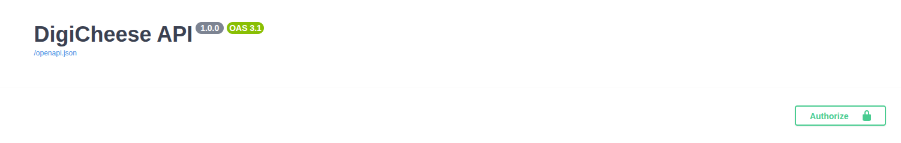

# 🧀 DIGICHEESE — TP Diginamic (UML + socle dev)

## 📌 Sommaire

* [1. 🧭 Contexte](#1--contexte)
* [2. 🎯 Objectifs pédagogiques](#2--objectifs-pédagogiques)
* [3. 🗂️ Arborescence (principale)](#3--arborescence-principale)
* [4. 🧑‍🤝‍🧑 Organisation du projet](#4--organisation-du-projet)
* [5. Guide d'utilisation du projet](#5-guide-dutilisation-du-projet)

--------------------

## 1. 🧭 Contexte
DIGICHEESE est une fromagerie régionale (≈ 130 salariés), entreprise familiale de plus d’un siècle,
qui vend ses produits :
- aux grands distributeurs
- aux particuliers qui se rendent physiquement à la boutique de l’usine

Ce dépôt est réalisé dans le cadre d’un **TP de la formation Diginamic**.
L’objectif est de produire des livrables structurés (UML, scénarios, conception) et de préparer un socle
de développement exploitable (architecture, tests, exécution).

> Statut : TP pédagogique (prioritaire) + socle dev (évolutif)

---

## 2. 🎯 Objectifs pédagogiques
- Modéliser un besoin métier (acteurs, cas d’utilisation, scénarios)
- Produire des diagrammes UML (use case, séquence, activité, classes / ERD selon sujet)
- Structurer un projet comme un vrai dépôt de développement :
  - séparation des responsabilités (routes / services / repositories)
  - configuration
  - tests automatisés de base
  - documentation (fonctionnelle, technique et d’utilisation)

#### Livrables attendus (rappel consignes)
- Code Python structuré par projet (**src/** + scripts associés si besoin)
- Tests : scénarios + scripts (dossier **tests/** + éventuellement scripts d’exécution)
- Documentation :
  - **DOC/** : documentation technique + documentation d’utilisation (avec un README équipe/rôles)
  - **DOC/TECH/** : architecture, éléments modifiés selon le cahier des charges, description des environnements Python

---

## 3. 🗂️ Arborescence (principale)
- `src/` : code source (structure imposée par le cours)
  - `routes/` : endpoints / contrôleurs
  - `services/` : logique métier
  - `repositories/` : accès données
  - `models/` : modèles et structures
  - `conf/` : configuration
  - `utils/` : utilitaires
- `tests/` : tests automatisés (pytest)
- `DOC/` : documentation projet (évolutive)
  - `DOC/README.md` : doc centrale + équipe / rôles + index
  - `DOC/FONC/` : documentation fonctionnelle (contexte, périmètre, règles métier, parcours, backlog)
  - `DOC/UTILISATION/` : documentation d’utilisation (guide, FAQ)
  - `DOC/TECH/` : documentation technique (architecture, changements CDC, environnements Python)
- `UML/` : livrables UML + exports (peut contenir des éléments d’un autre cours)
- `docs_cours/` : supports / notes / documents liés aux cours

➡️ Point d’entrée documentation : **`DOC/README.md`**

------------

## 4. 🧑‍🤝‍🧑 Organisation du projet

#### a. Résumé du projet

- Backend API Python + MySQL
- CRUD (Create Read Update Delete)
- Documentation Swagger
- Tests via Pytest

> **MVP attendu**:
>
> CRUD Admin (swagger)
>
> CRUD Operateur Colis (Gestion client)
>
> Une branche par développeur et les branches : test, dev, prod et master
>
> Sources python par projet (SOURCES PYTHON, Scripts, Mysql)
>
> Un dossier avec la documentation technique et d’utilisation (Dans un README.md avec présentation de l’équipe et leur rôle)
>
> Un dossier contenant les scénarii de tests et les scripts
>
> Un dossier contenant la documentation technique (contenant l’architecture, les éléments changés selon le cahier des charges fournis, la description des serveurs virtuels python)
>
> Le détail du backlog, des rôles et des conventions est dans : DOC/README.md et DOC/UTILISATION/Guide_dev.md.
>
> Le périmètre et les règles métier sont dans : DOC/FONC/*.

#### b. Mise en place

1. setup GitHub
2. Création de branches par dev
3. Création d'autres branches (dev etc..)
4. Définition des besoins clients
5. Définition de l'env de travail (bibliotheque, technologies, etc.. )
6. Création d'un backlog (tout ce qui est nécessaire a réaliser le projet)
7. Relevé des paramètres (classes, methodes)
8. Définir les étapes de devs
9. Assignation des taches (sprint backlog)

## 5. Guide d'utilisation du projet

### 🚀 Quickstart (VS Code Terminal — PowerShell)

> Nous utilisons le terminal intégré de VS Code, généralement PowerShell sous Windows.
> Si tu utilises **Git Bash**, l’activation de l’environnement virtuel change

### a) 🧰 Pré-requis
- Python 3.13
- Git
- Docker et docker compose

### b) ⬇️ Cloner le dépôt
```bash
git clone https://github.com/xavier-deguercy/TP_digicheese.git
cd TP_digicheese
```

### c) Créer et activer l’environnement virtuel
```bash
py -3.13 -m venv .venv
.\.venv\Scripts\Activate.ps1
```

Si le lanceur Windows ne détecte pas Python 3.13, utiliser le runtime géré par
[`uv`](https://docs.astral.sh/uv/) :

```powershell
uv python install 3.13
uv venv --python 3.13 --seed .venv
.\.venv\Scripts\Activate.ps1
```

#### (Optionnel) Mise à jour de pip
```bash
python -m pip install --upgrade pip
```

### d) ⬇️ Installer les dépendances
```bash
python -m pip install -r requirements.txt
python -m pip check
```

### e) ⚙️ Configurer l'environnement

Copier l'exemple local, puis remplacer le mot de passe factice par celui de votre
environnement Docker. Le fichier `.env` reste local et ne doit pas être ajouté à Git.

```powershell
Copy-Item .env.example .env
```

`DATABASE_URL` est obligatoire. Une variable définie dans le terminal est prioritaire
sur la valeur de `.env`. Laisser `DISABLE_AUTH=false` hors des tests automatisés.

### f) 🐳 Démarrer la base de données (Docker)
Lancer le docker compose :
```bash
docker compose up -d
```

> *Si vous souhaitez reset entièrement la base que vous avez déjà :*
> ```bash
> docker compose down -v
> ```
> *puis rallumez votre compose avec la commande ci-dessus*


### g) 🐬 MySQL

Grâce à ce compose, vous pouvez interagir directement avec votre bdd via mysql avec :
```bash
docker exec -it digicheese-mysql bash
```

Une fois dans le container, vous pouvez accéder à la base avec :

```bash
mysql -u group2 -p
password: digicheese
USE digicheese;
```

### h) 🧾 phpMyAdmin

Pour une représentation graphique, vous avez également accès à un serveur phpMyAdmin exposé ici :

- URL : http://localhost:8080
- Serveur : mysql
- Utilisateur : group2
- Mot de passe : digicheese

### i) ⚡ Démarrage du serveur FastAPI
#### Lancer le serveur FastAPI en mode développement (reload auto):

```bash
uvicorn src.main:app --reload
```

#### Créer un Admin User et les rôles
Ouvrir un autre terminal, et lancer la commande :

```bash
python -m src.utils.create_db
```

### j) Navigation dans Swagger

**Liste des rôles :**
  - Admin (id = 1)
  - OP-COLIS (id = 2)
  - OP-STOCK (id = 3)

**Rendez-vous sur Swagger** : http://localhost:8000/docs

>Tout en haut de swagger, vous avez une route ```get_api_key```.
>Vous pouvez récupérer l'api_key de l'admin (**id_user = 1**)

Copier coller cet API_KEY dans l'encart Authorize tout en haut de la fenêtre swagger.



> ⚠️ Important — Authentification Swagger
>
> L’API est protégée par une authentification Swagger.
> Après avoir **exécuté le script ci-dessus**, utilisez impérativement le token générée par le script (copier-coller exact) pour accéder aux routes Swagger.
>
> 👉 **L’authentification ne fonctionnera pas n'utilisez pas le token.**

Votre session est désormais activée avec le rôle Admin. Vous pouvez maintenant créer un utilisateur, avec un autre rôle, et refaire de même pour utiliser une session OP-COLIS par exemple.

**Recommandation de navigation pour la gestion de client :**

- Créer d'abord une commune
- Puis créer une adresse
- Puis enfin, vous pouvez lier votre client à une ou plusieurs adresses

### k) 🧪 Tests automatisés

**Lancer toute la suite depuis la racine du projet :**

```powershell
python -m pytest -q
```

**Lancer un test en particulier :**

```powershell
python -m pytest tests/test_feature.py -k nom_du_test
```

Les tests CRUD neutralisent actuellement l'authentification et utilisent SQLite en
mémoire. Leur réussite ne valide donc pas l'IAM ni l'intégration MySQL.

### l) Fermer le projet

```bash
docker compose down #(-v pour supprimer la base)
```

+ 'CTRL + C' sur le terminal du serveur pour fermer le serveur


## Équipe & contacts

| Contributeur | LinkedIn | GitHub |
|---|---|---|
| Stanislas DELANNOY | [Profil LinkedIn](https://www.linkedin.com/in/stanislas-delannoy-alternance-data/) | [Profil GitHub](https://github.com/stanislasdelannoy) |
| Imen KHAMMASSI | [Profil LinkedIn](https://www.linkedin.com/in/imen-khammassi-509b06239/) | [Profil GitHub](https://github.com/Imen123988) |
| Thi Thu Hien NGUYEN | [Profil LinkedIn](https://www.linkedin.com/in/thi-thu-hien-nguyen-17a76263/) | [Profil GitHub](https://github.com/Hiennguyenalice) |
| Xavier DEGUERCY | [Profil LinkedIn](https://www.linkedin.com/in/xavierdeguercy/) | [Profil GitHub](https://github.com/xavier-deguercy) |
