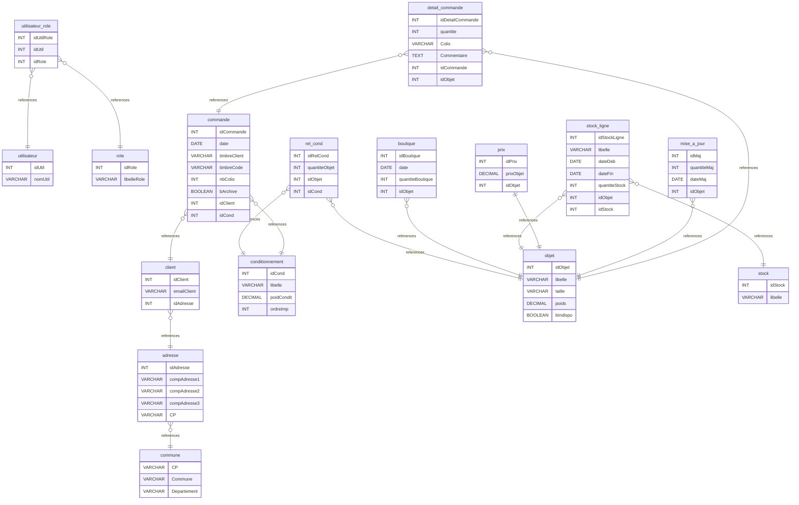

# modelisation_base_xavier documentation
## Summary

- [Introduction](#introduction)
- [Database Type](#database-type)
- [Table Structure](#table-structure)
	- [utilisateur](#utilisateur)
	- [role](#role)
	- [utilisateur_role](#utilisateur_role)
	- [commune](#commune)
	- [adresse](#adresse)
	- [client](#client)
	- [conditionnement](#conditionnement)
	- [commande](#commande)
	- [objet](#objet)
	- [detail_commande](#detail_commande)
	- [mise_a_jour](#mise_a_jour)
	- [prix](#prix)
	- [stock](#stock)
	- [stock_ligne](#stock_ligne)
	- [boutique](#boutique)
	- [rel_cond](#rel_cond)
- [Relationships](#relationships)
- [Database Diagram](#database-diagram)

## Introduction

## Database type

- **Database system:** MySQL
## Table structure

### utilisateur

| Name        | Type          | Settings                      | References                    | Note                           |
|-------------|---------------|-------------------------------|-------------------------------|--------------------------------|
| **idUtil** | INT | 🔑 PK, not null, unique, autoincrement |  | |
| **nomUtil** | VARCHAR | not null |  | | 

### role

| Name        | Type          | Settings                      | References                    | Note                           |
|-------------|---------------|-------------------------------|-------------------------------|--------------------------------|
| **idRole** | INT | 🔑 PK, not null, unique, autoincrement |  | |
| **libelleRole** | VARCHAR | not null |  | | 

### utilisateur_role
Table technique ajoutée pour matérialiser la relation n-n entre utilisateur et role.
| Name        | Type          | Settings                      | References                    | Note                           |
|-------------|---------------|-------------------------------|-------------------------------|--------------------------------|
| **idUtilRole** | INT | 🔑 PK, not null, unique, autoincrement |  | |
| **idUtil** | INT | not null | fk_utilisateur_role_utilisateur | |
| **idRole** | INT | not null | fk_utilisateur_role_role | | 

### commune

| Name        | Type          | Settings                      | References                    | Note                           |
|-------------|---------------|-------------------------------|-------------------------------|--------------------------------|
| **CP** | VARCHAR | 🔑 PK, not null, unique |  | |
| **Commune** | VARCHAR | not null |  | |
| **Departement** | VARCHAR | not null |  | | 

### adresse

| Name        | Type          | Settings                      | References                    | Note                           |
|-------------|---------------|-------------------------------|-------------------------------|--------------------------------|
| **idAdresse** | INT | 🔑 PK, not null, unique, autoincrement |  | |
| **compAdresse1** | VARCHAR | not null |  | |
| **compAdresse2** | VARCHAR | null |  | |
| **compAdresse3** | VARCHAR | null |  | |
| **CP** | VARCHAR | not null | fk_adresse_commune | | 

### client

| Name        | Type          | Settings                      | References                    | Note                           |
|-------------|---------------|-------------------------------|-------------------------------|--------------------------------|
| **idClient** | INT | 🔑 PK, not null, unique, autoincrement |  | |
| **emailClient** | VARCHAR | not null, unique |  | |
| **idAdresse** | INT | not null | fk_client_adresse | | 

### conditionnement

| Name        | Type          | Settings                      | References                    | Note                           |
|-------------|---------------|-------------------------------|-------------------------------|--------------------------------|
| **idCond** | INT | 🔑 PK, not null, unique, autoincrement |  | |
| **libelle** | VARCHAR | not null |  | |
| **poidCondit** | DECIMAL | not null |  | |
| **ordreImp** | INT | null |  | | 

### commande

| Name        | Type          | Settings                      | References                    | Note                           |
|-------------|---------------|-------------------------------|-------------------------------|--------------------------------|
| **idCommande** | INT | 🔑 PK, not null, unique, autoincrement |  | |
| **date** | DATE | not null |  | |
| **timbreClient** | VARCHAR | null |  | |
| **timbreCode** | VARCHAR | null |  | |
| **nbColis** | INT | null |  | |
| **bArchive** | BOOLEAN | not null |  | |
| **idClient** | INT | not null | fk_commande_client | |
| **idCond** | INT | null | fk_commande_conditionnement | | 

### objet

| Name        | Type          | Settings                      | References                    | Note                           |
|-------------|---------------|-------------------------------|-------------------------------|--------------------------------|
| **idObjet** | INT | 🔑 PK, not null, unique, autoincrement |  | |
| **libelle** | VARCHAR | not null |  | |
| **taille** | VARCHAR | null |  | |
| **poids** | DECIMAL | null |  | |
| **bIndispo** | BOOLEAN | not null |  | | 

### detail_commande
Clé technique ajoutée pour faciliter l'implémentation relationnelle.
| Name        | Type          | Settings                      | References                    | Note                           |
|-------------|---------------|-------------------------------|-------------------------------|--------------------------------|
| **idDetailCommande** | INT | 🔑 PK, not null, unique, autoincrement |  | |
| **quantite** | INT | not null |  | |
| **Colis** | VARCHAR | null |  | |
| **Commentaire** | TEXT | null |  | |
| **idCommande** | INT | not null | fk_detail_commande_commande | |
| **idObjet** | INT | not null | fk_detail_commande_objet | | 

### mise_a_jour

| Name        | Type          | Settings                      | References                    | Note                           |
|-------------|---------------|-------------------------------|-------------------------------|--------------------------------|
| **idMaj** | INT | 🔑 PK, not null, unique, autoincrement |  | |
| **quantiteMaj** | INT | not null |  | |
| **dateMaj** | DATE | not null |  | |
| **idObjet** | INT | not null | fk_mise_a_jour_objet | | 

### prix
Modélisé ici en 1-1 avec objet via une FK unique.
| Name        | Type          | Settings                      | References                    | Note                           |
|-------------|---------------|-------------------------------|-------------------------------|--------------------------------|
| **idPrix** | INT | 🔑 PK, not null, unique, autoincrement |  | |
| **prixObjet** | DECIMAL | not null |  | |
| **idObjet** | INT | not null, unique | fk_prix_objet | | 

### stock

| Name        | Type          | Settings                      | References                    | Note                           |
|-------------|---------------|-------------------------------|-------------------------------|--------------------------------|
| **idStock** | INT | 🔑 PK, not null, unique, autoincrement |  | |
| **libelle** | VARCHAR | not null |  | | 

### stock_ligne

| Name        | Type          | Settings                      | References                    | Note                           |
|-------------|---------------|-------------------------------|-------------------------------|--------------------------------|
| **idStockLigne** | INT | 🔑 PK, not null, unique, autoincrement |  | |
| **libelle** | VARCHAR | null |  | |
| **dateDeb** | DATE | null |  | |
| **dateFin** | DATE | null |  | |
| **quantiteStock** | INT | not null |  | |
| **idObjet** | INT | not null | fk_stock_ligne_objet | |
| **idStock** | INT | null | fk_stock_ligne_stock | | 

### boutique

| Name        | Type          | Settings                      | References                    | Note                           |
|-------------|---------------|-------------------------------|-------------------------------|--------------------------------|
| **idBoutique** | INT | 🔑 PK, not null, unique, autoincrement |  | |
| **date** | DATE | null |  | |
| **quantiteBoutique** | INT | null |  | |
| **idObjet** | INT | not null | fk_boutique_objet | | 

### rel_cond
Interprété comme table de relation entre objet et conditionnement.
| Name        | Type          | Settings                      | References                    | Note                           |
|-------------|---------------|-------------------------------|-------------------------------|--------------------------------|
| **idRelCond** | INT | 🔑 PK, not null, unique, autoincrement |  | |
| **quantiteObjet** | INT | not null |  | |
| **idObjet** | INT | not null | fk_rel_cond_objet | |
| **idCond** | INT | not null | fk_rel_cond_conditionnement | | 

## Relationships

- **utilisateur_role to utilisateur**: many_to_one
- **utilisateur_role to role**: many_to_one
- **adresse to commune**: many_to_one
- **client to adresse**: many_to_one
- **commande to client**: many_to_one
- **commande to conditionnement**: many_to_one
- **detail_commande to commande**: many_to_one
- **detail_commande to objet**: many_to_one
- **mise_a_jour to objet**: many_to_one
- **prix to objet**: one_to_one
- **stock_ligne to objet**: many_to_one
- **stock_ligne to stock**: many_to_one
- **boutique to objet**: many_to_one
- **rel_cond to objet**: many_to_one
- **rel_cond to conditionnement**: many_to_one

## Database Diagram

